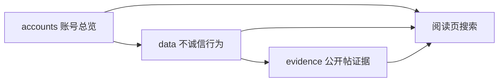

# 公开记录

不会看代码的话，用浏览器打开 [index.html](index.html)。

页面可以搜索账号。搜到以后会显示：

1. 这个账号的总览
2. 它的全部不诚信行为
3. 每项行为下面的公开帖
4. 这个账号是否已停用，或是否改过名

只在 GitHub 上往下读的话，打开 [阅读.md](阅读.md)。那一页不能搜索。

不收录真实姓名、电话、住址、身份证、私人聊天。标成「示例」的不是真实账号。已整理不等于法院判决。

每个账号按平台用户编号唯一追踪。改名、停用都还是这一条。只有另外开一个新号，才不会自动并进来。

## 三个文件夹怎么连

账号文件里的 `behaviors` 指向 `data/behaviors/`。行为文件里的 `evidence` 指向 `evidence/`。改名后编号和文件夹都不搬，曾用名仍可搜索。

GitHub 每周一核对正式账号。发现已停用或已改名时，会开一个拉取请求把标记写上。示例账号不核对。同一天也会用公开搜索找中文抽 iPhone 的帖：粉丝超过 100 万的不收；只有帖子自己写明不是作者发奖，才会自动写成待核对。怎么加记录、怎么锁定标记，见 [CONTRIBUTING.md](CONTRIBUTING.md)。
